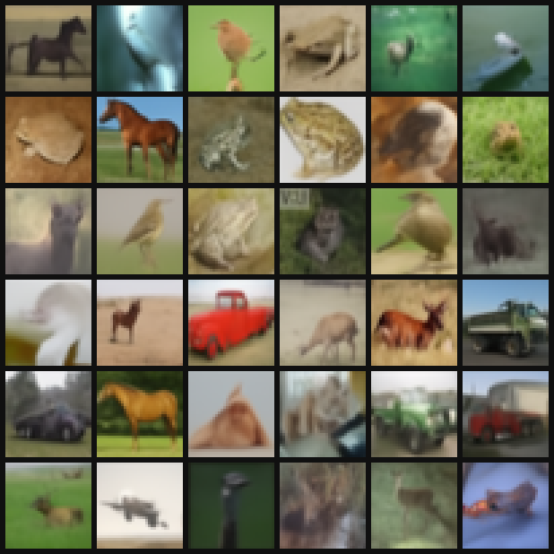
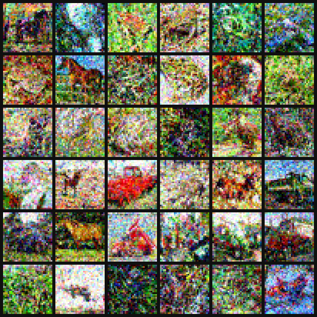

# Improved DDPM: what the evidence supports

A re-evaluation of *Improved Denoising Diffusion Probabilistic Models* (Nichol & Dhariwal, ICML 2021) with the authors' released code and checkpoints. It checks the paper's main claims, adds the measurements a deployer would need (latency per image, behaviour under dataset shift), and includes the slides and the interactive demo from a short talk on the paper.

## Findings at a glance

| Claim in the paper | Evidence | Verdict |
|---|---|---|
| 50 to 100 sampling steps with little loss in quality | Fig. 8; my run at 50 steps: FID 34 with the learned variance vs 87 with fixed σ² = β (real images: 30 at the same sample size) | Supported, but each image still costs 50 network calls |
| Competitive likelihood while keeping sample quality | The best NLL (2.94 bits/dim) comes from the L_vlb model, whose FID is 11.47; the good-sample L_hybrid model has 3.17, behind PixelCNN (3.14) | Partly: two different models |
| Better likelihood means the model covers its data (implied) | Trained on CIFAR-10, tested on SVHN: OOD AUROC 0.10 in my run, 0.091 in Heng et al. (2024) | Fails under dataset shift |
| Higher recall than GANs | One BigGAN-deep baseline trained in-house, one run each; re-scoring by the same authors moved recall by about 0.1 | Direction holds, scope overstated |

The full claim-by-claim audit, the "train on one dataset, test on another" analysis and the proposed deployment metrics are in [FINDINGS.md](FINDINGS.md). Slides: [slides/Improved_DDPM_Talk.pdf](slides/Improved_DDPM_Talk.pdf).

## Results

Measured with the released checkpoints on an RTX 3050 Ti laptop GPU (4 GB).

<table>
  <tr>
    <td align="center"></td>
    <td align="center"></td>
  </tr>
  <tr>
    <td align="center">Learned variance Σθ, 10 steps</td>
    <td align="center">Fixed σ² = β, 10 steps</td>
  </tr>
</table>

Same network and same starting noise; only the variance rule differs.

| Measure | Result |
|---|---|
| Latency, batch size 1 | 43 ms per network call; 0.44 / 2.1 / 10.9 / 44 / 182 s per image at K = 10 / 50 / 250 / 1000 / 4000 steps |
| FID, 1,000 samples (real test images score 30.4 at this n) | learned Σθ 59.7 / 34.2 / 31.9 at K = 10 / 50 / 250; fixed σ² = β 267 / 87 / 38; fixed β̃ 63 / 38 / 33; DDIM 45 / 36 / 33 |
| Bits/dim, CIFAR-10 L_hybrid model | CIFAR-10 test 3.25, train 3.16, upside-down 3.34, heavy pixel noise 8.46, SVHN 2.28 |
| OOD AUROC (score = bits/dim, CIFAR-10 test as reference) | SVHN 0.10 (backwards), upside-down 0.53 (chance), heavy noise 1.00 (caught); best-NLL L_vlb model on SVHN 0.19 |
| Probe images | plain black 0.11 and plain grey 0.15 bits/dim, against about 3.35 for CIFAR-10 photos |
| Full 4000-step bound, 32 test images | L_hybrid 3.37, L_vlb 3.15 bits/dim; the first 1% of steps carry 71% of the per-step terms |
| Nearest training image (pixel L2, median) | generated 8.83 vs held-out test 9.22; the six closest pairs are different images |

Raw numbers: [results/fid/fid_results.json](results/fid/fid_results.json), [results/ood/summary.json](results/ood/summary.json), [results/latency_bs1.json](results/latency_bs1.json), [results/pipeline_log.txt](results/pipeline_log.txt).

## Repository layout

```
FINDINGS.md        claim-by-claim audit, dataset-shift analysis, deployment metrics, references
slides/            talk slides (PDF)
scripts/           experiments, run on top of openai/improved-diffusion
results/           summary results: JSON, per-image OOD scores, VLB terms, sample grids, run log
app/               interactive demo: static page with recorded runs, optional live GPU server
requirements.txt
```

| Script | What it does |
|---|---|
| `scripts/common.py` | builds the official models and diffusion processes from the authors' published flags |
| `scripts/00_prepare_data.py` | converts the CIFAR-10 and SVHN parquet files to `.npy` arrays |
| `scripts/01_benchmark.py` | time per network call against batch size |
| `scripts/02_pipeline.py` | all experiments in resumable stages: samples, trajectories, latency, OOD, ImageNet, nearest neighbours, VLB terms, FID |
| `scripts/06_probe_bpd.py` | bits/dim of simple probe images (black, grey, gradient, checkerboard, noise) |
| `scripts/03_export_data.py` | packs results into `app/assets/data/demo_data.js` |
| `scripts/04_record_replay.py` | records the runs the offline demo plays back |
| `scripts/05_inline_fonts.py` | embeds the web fonts so the demo works when opened from disk |

## Reproducing

1. **Environment.** Python 3.12. Install PyTorch with CUDA from [pytorch.org](https://pytorch.org) (tested with 2.11 and CUDA 12.8), then `pip install -r requirements.txt`.
2. **Official code.** Clone it into `third_party/` at the commit used here:
   ```bash
   git clone https://github.com/openai/improved-diffusion third_party/improved-diffusion
   git -C third_party/improved-diffusion checkout 1bc7bbb
   ```
3. **Checkpoints.** Download into `checkpoints/`:
   - [cifar10_uncond_50M_500K.pt](https://openaipublic.blob.core.windows.net/diffusion/march-2021/cifar10_uncond_50M_500K.pt) (L_hybrid)
   - [cifar10_uncond_vlb_50M_500K.pt](https://openaipublic.blob.core.windows.net/diffusion/march-2021/cifar10_uncond_vlb_50M_500K.pt) (L_vlb)
   - [imagenet64_uncond_100M_1500K.pt](https://openaipublic.blob.core.windows.net/diffusion/march-2021/imagenet64_uncond_100M_1500K.pt)
4. **Data.** Save the Hugging Face parquet files of CIFAR-10 (`uoft-cs/cifar10`) as `data/cifar10/train.parquet` and `data/cifar10/test.parquet`, and SVHN cropped digits (`ufldl-stanford/svhn`, `cropped_digits`) as `data/svhn/test.parquet`. Then run `python scripts/00_prepare_data.py`.
5. **Experiments.** About 3 hours on a laptop RTX 3050 Ti; stages resume if interrupted.
   ```bash
   python scripts/02_pipeline.py
   python scripts/06_probe_bpd.py
   python scripts/03_export_data.py
   python scripts/04_record_replay.py
   ```

Sampling uses fp16 autocast (maximum |Δε| about 0.006 against fp32); likelihoods are computed in fp32.

## Demo

- **Offline:** open `app/index.html` in a browser. It plays runs recorded with the same code.
- **Live:** with the checkpoints in place, run `python app/server.py` and open `http://127.0.0.1:8766/`.
- **Keys:** `←`/`→` change scene, `B` opens the question scenes, `↑`/`↓` change the step or K, `G` generates, `V` switches the variance, `F` full screen.

## Caveats

- The fixed-variance comparison is an inference-time ablation on one L_hybrid network; the paper's Fig. 8 compares separately trained models.
- FID uses 1,000 samples (the paper uses 50,000), so it is biased upward; compare the ordering and the real-image floor, not the absolute values.
- Bits/dim is a variational bound from the paper's Appendix E evaluation schedule, on 500 images per set: suitable for ranking, not an exact NLL.
- The nearest-neighbour check uses 36 samples and cannot rule out memorization; Carlini et al. (2023) extracted 301 training images from 1M samples of the same checkpoint.
- All timings come from one laptop GPU at batch size 1.

## References

- Nichol, A. Q., & Dhariwal, P. (2021). Improved denoising diffusion probabilistic models. ICML. [arXiv:2102.09672](https://arxiv.org/abs/2102.09672)
- Ho, J., Jain, A., & Abbeel, P. (2020). Denoising diffusion probabilistic models. NeurIPS.
- Song, J., Meng, C., & Ermon, S. (2021). Denoising diffusion implicit models. ICLR.
- Nalisnick, E., et al. (2019). Do deep generative models know what they don't know? ICLR.
- Heng, A., Thiery, A. H., & Soh, H. (2024). Out-of-distribution detection with a single unconditional diffusion model. NeurIPS.
- Carlini, N., et al. (2023). Extracting training data from diffusion models. USENIX Security.

The full list is at the end of [FINDINGS.md](FINDINGS.md).

## Third-party material

- Code and checkpoints: [openai/improved-diffusion](https://github.com/openai/improved-diffusion) (MIT license). Neither is redistributed here.
- Datasets: CIFAR-10 (Krizhevsky, 2009) and SVHN (Netzer et al., 2011). They are not redistributed; the demo data embeds a few example images for illustration.
- Fonts: Source Serif 4 and Source Sans 3 (SIL Open Font License 1.1), in `app/assets/fonts`.

## Use of generative AI

Claude (Anthropic) helped me study the paper, write the experiment and demo code, and draft the slides and documents. ChatGPT and Codex (OpenAI) gave feedback on the demo design. Every number comes from the paper or from my own runs of the released checkpoints.
